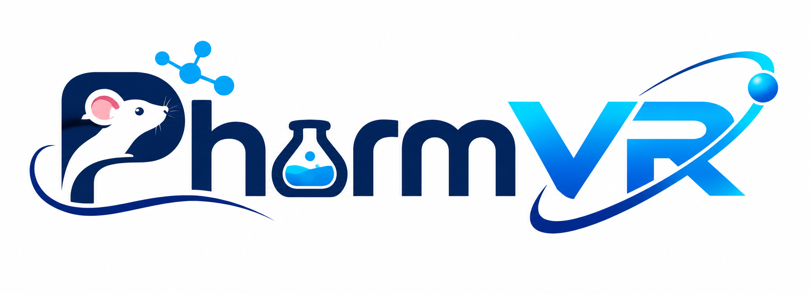

<div align="center">



### The interactive pharmacology laboratory

**[Open the lab →](https://pharmvr.github.io)**  ·  **[Research preprint](https://www.preprints.org/manuscript/202507.0959)**  ·  **[LinkedIn](https://www.linkedin.com/in/karthik-thiyagarajan/)**


</div>

---

A free, browser-based replacement for the ageing ExPharm software used to teach
experimental pharmacology. **All 31 experiments** of the standard practical
syllabus, running on any device, with no install, no login and no cost.

Built and maintained by **Dr. Karthik Thiyagarajan, Pharm.D**.

---

## What makes it different

Most teaching simulators play back a scripted animation: press the button, watch
the predetermined result. PharmVR doesn't. **The pharmacology is modelled, and the
classical teaching results emerge from the model.**

That distinction is the whole engineering argument:

| | Scripted simulator | PharmVR |
|---|---|---|
| Dose–response | Lookup table | **Hill equation**, fitted live by least squares |
| Antagonism | Hard-coded "blocked" | **Dose ratio** from a real EC₅₀ shift |
| Antagonist affinity | Printed constant | **Schild regression**, pA₂ from the x-intercept |
| Bioassay | Given answer | **Parallel-line arithmetic**, with a parallelism validity check |
| Unknown samples | Fixed | Randomised per run, graded against truth |

So a student who gives d-tubocurarine and repeats an acetylcholine curve sees a
parallel rightward shift with the maximum preserved — because that is what the
equations do, not because a designer drew it that way.

## Highlights

<table>
<tr><td width="50%">

**Smoked-drum kymograph**
A rotating cylinder with the trace wrapped onto its visible face, signal marks
for every drug addition and 10-second time markers — exactly as it appears on a
real drum. Multi-channel, so the perfused-heart experiment writes coronary
outflow above the force tracing.

</td><td width="50%">


</td></tr>
<tr><td width="50%">

**Schild plot (exp 15)**
Run the histamine curve at four mepyramine concentrations, and the app regresses
log(DR − 1) on log[B]. The slope tests whether the antagonism is simple and
competitive; the intercept recovers pA₂ ≈ 9.1, the textbook value — from the
student's own readings.

</td><td width="50%">


</td></tr>
</table>


## The 31 experiments

**CNS & behavioural** — rota-rod · actophotometer · tail flick · hot plate ·
elevated plus maze · MES · PTZ
**Isolated tissue** — rabbit intestine · frog rectus abdominis · ACh
concentration–response · histamine CRC · **Schild / pA₂** · 3-point bioassay ·
4-point bioassay · rat uterus
**Cardiovascular** — frog heart (Straub) · perfused frog heart · blood pressure
(vasomotor reversal) · Dale's vasoperfusion
**Special & toxicology** — rabbit eye · histamine aerosol chamber · local
anaesthetic wheal · LD₅₀ · paw oedema · antipyretic · diuretic · hypoglycaemic ·
charcoal meal · antiemetic · ciliary motility · pharmacokinetics

## Engineering

Plain HTML, CSS and JavaScript. **No framework, no build step, no package
manager, no dependencies** — which is why it still works offline-ish on a college
PC and will still work in ten years.

```
js/lab/
  core.js        canvas primitives, tweens, particles, charts
  engine.js      LabEngine — the 3-column shell every experiment inherits
  kymograph.js   smoked drum, multi-channel wrapped trace
  organbath.js   organ bath + frontal writing lever   (7 experiments)
  heartrig.js    cannula, beating frog heart, lever   (2 experiments)
  pharm.js       Hill fit · Schild regression · bioassay arithmetic
  rodent.js      procedural animated mouse/rat
  guineapig.js   procedural animated guinea pig
  exp/*.js       31 experiment modules
```

Every scene is **drawn procedurally on a 960×540 canvas** — glassware, animals,
instruments, traces. There are no scene images to load, which keeps the whole
site a few megabytes and makes it sharp at any resolution.

## Roadmap

- **Phase 1 — live.** All 31 experiments, free, in the browser.
- **Phase 2 — in progress.** Printable observation sheets, assessment mode,
  institutional progress tracking.
- **Phase 3 — seeking funding.** A full immersive **3D/VR pharmacology
  laboratory** on the same validated simulation core. The research case is set
  out in the [preprint](https://www.preprints.org/manuscript/202507.0959).

**Collaborators, institutions and funders are welcome** — please get in touch via
[LinkedIn](https://www.linkedin.com/in/karthik-thiyagarajan/).

## Licence

**Free to use. Not open source.**

© 2026 Dr. Karthik Thiyagarajan. All rights reserved. You may use the site freely
for study and teaching, and cite it in academic work. Copying, re-hosting,
modifying or redistributing the code, models or artwork is not permitted without
written permission. See [LICENSE](LICENSE).

---

<div align="center"><sub>Built for pharmacy and medical students everywhere.</sub></div>
